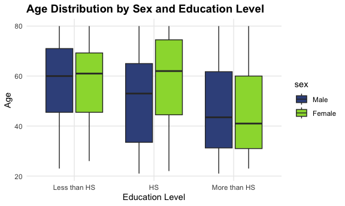
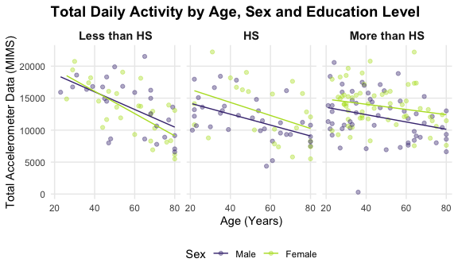
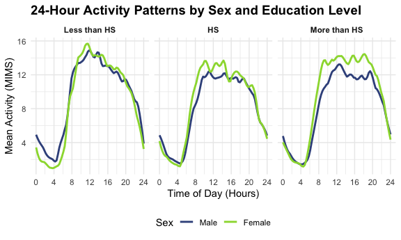

P8105 Homework 3
================
Lina Marcinczyk
2026-10-13

## Problem 1

#### Loading and inspecting NY NOAA dataset

``` r
library(p8105.datasets)
data("ny_noaa")
```

The NY NOAA dataset contains 2595176 observations and 7 variables,
representing weather measurements collected at different stations over
time. The variables include station ID (`id`), observation date
(`date`), precipitation (`prcp`), snowfall (`snow`), snow depth
(`snwd`), maximum temperature (`tmax`), and minimum temperature
(`tmin`). The station ID and temperature variables are stored as
character values, the date is stored as a date variable, and the
precipitation and snow measurements are stored as integers.

The dataset contains 3387623 missing values overall. Maximum temperature
(`tmax`) has 1134358 missing observations (43.7%), while minimum
temperature (`tmin`) has 1134420 missing observations (43.7%). In
contrast, station ID and date have no missing values.

#### Cleaning the dataset

``` r
ny_noaa_clean = ny_noaa |> 
  mutate(
    year = year(date), 
    month = month(date),
    day = day(date), 
    prcp = prcp / 10, 
    tmax = as.numeric(tmax) / 10, 
    tmin = as.numeric(tmin) / 10
  )
```

#### Snowfall Observations

``` r
ny_noaa_clean |> 
  filter(!is.na(snow)) |> 
  count(snow) |> 
  arrange(desc(n)) |> 
  slice_head(n =10)
```

    ## # A tibble: 10 × 2
    ##     snow       n
    ##    <int>   <int>
    ##  1     0 2008508
    ##  2    25   31022
    ##  3    13   23095
    ##  4    51   18274
    ##  5    76   10173
    ##  6     8    9962
    ##  7     5    9748
    ##  8    38    9197
    ##  9     3    8790
    ## 10   102    6552

The most commonly observed snowfall value is 0 mm, which makes sense
because snowfall does not occur every day. The next most common values
are 25 mm, 13 mm, and 51 mm, which approximately correspond to 1 inch,
0.5 inches, and 2 inches, respectively. This suggests that some snowfall
measurements may have originally been recorded in inches and converted
to millimeters.

#### January and July temps over the years

``` r
ny_noaa_clean |> 
  filter(month %in% c(1, 7)) |> 
  group_by(year, month, id) |> 
  summarize(
    mean_tmax = mean(tmax, na.rm = TRUE),
    .groups = "drop"
  ) |> 
  filter(!is.na(mean_tmax)) |> 
  mutate(
    month = factor(
      month, 
      levels = c(7, 1), 
      labels = c("July", "January")
    )
  ) |> 
  ggplot(aes(x = year, y = mean_tmax)) +
  geom_point(
    aes(color = month),
    alpha = .25,
    size = 0.8
    ) +
  geom_smooth(
    aes(color = month),
    method = "lm",
    se = FALSE, 
    linewidth = 0.8
  ) +
  facet_grid(month ~ ., scales = "free_y", switch = "y") +
  scale_color_viridis_d(
  option = "viridis",
  begin = 0.15,
  end = 0.85
) +
  labs(
    title = "Average Max Temperatures in New York",
    subtitle = "January and July temperatures across weather stations, 1981 - 2010",
    x = "Year",
    y = "Average Max Temp (°C)",
    caption = "Each point represents one station's monthly average",
  ) +
  theme_minimal() +
  theme(
    legend.position = "none",
    plot.title = element_text(face = "bold", size = 14),
    strip.placement = "outside",
    strip.text.y.left = element_text(angle = 0, face = "bold"),
    strip.text = element_text(face = "bold", size = 11), 
    panel.grid.minor = element_blank()
  )
```

    ## `geom_smooth()` using formula = 'y ~ x'


This graph shows clear seasonal differences, as shown with consistently
higher averages in July as compared to January. The trendline shows a
slight increase in January temps from 1981 to 2010, while July temps
remain more or less stable. January temps seem to be more variable than
July ones. There are potential outliers in January around 1982 and 2004,
and in July around 1988 and 2004.

#### Tmax vs Tmin plot

``` r
ny_noaa_clean |>
  filter(!is.na(tmax), !is.na(tmin)) |>
  ggplot(aes(x = tmin, y = tmax)) +
  geom_hex() +
  labs(
  title = "Maximum vs Minimum Temperatures",
  subtitle = "Daily temperatures across New York weather stations, 1981–2010",
  x = "Minimum Temperature (°C)",
  y = "Maximum Temperature (°C)",
  fill = "Observations"
) +
theme_minimal() +
theme(
  plot.title = element_text(face = "bold", size = 14),
  legend.position = "right",
  panel.grid.minor = element_blank()
)
```


This hexagonal plot shows a strong positive relationship between daily
minimum and maximum temperatures across New York weather stations. The
highest concentration of observations occurs at the more moderate
temperatures, with minimum temperatures around 0–20°C and maximum
temperatures around 5–30°C. Some extreme observations are seen, both
unusually high and low temperatures, which may suggest outliers or other
data-quality issues.

#### Snowfall plot

2)  make a plot showing the distribution of snowfall values greater than
    0 and less than 100 separately by year.

``` r
ny_noaa_clean |>
  filter(snow > 0, snow < 100) |> 
  ggplot(aes(x = factor(year), y = snow, fill = factor(year))) +
  geom_boxplot(
    alpha = 0.8,
    width = 0.7,
    outlier.size = 1
  ) +
  labs(
  title = "Snowfall Over the Years",
  subtitle = "Snowfall Measured by Weather Stations Between 1981–2010",
  x = "Year",
  y = "Snowfall (mm)"
) +
theme_minimal() +
theme(
  plot.title = element_text(face = "bold", size = 14),
  legend.position = "none",
  panel.grid.minor = element_blank(),
  axis.text.x = element_text(angle = 90, hjust = 1)
)
```


This boxplot shows that the distribution of daily snowfall amounts
between 0 and 100 mm was relatively consistent across 1981–2010. The
median snowfall was approximately 25 mm in most years, while the middle
50% of observations generally ranged from about 13 to 51 mm. Although
some years showed slightly different variability and a few high snowfall
outliers, there was no clear overall trend in the median snowfall
amount. The similarity across years may partly reflect the concentration
of snowfall measurements at common values such as 13, 25, and 51 mm.
These results describe snowfall amounts on days with recorded snowfall
within the specified range, rather than total annual snowfall.

## Problem 2

#### Load, tidy, merge, and organize

``` r
demos_df =
  readr::read_csv("nhanes_demos.csv", skip = 4) |> 
  janitor::clean_names() |> 
  mutate(
    sex = factor(
      sex, 
      levels = c(1, 2), 
      labels = c("Male", "Female")
      ),
    education = factor(
      education, 
      levels = c(1, 2, 3),
      labels = c("Less than HS", "HS", "More than HS"),
      ordered = TRUE
    )
  ) |> 
  filter(
    age >= 21,
    !is.na(sex),
    !is.na(age),
    !is.na(bmi),
    !is.na(education)
  )
```

    ## Rows: 250 Columns: 5
    ## ── Column specification ────────────────────────────────────────────────────────
    ## Delimiter: ","
    ## dbl (5): SEQN, sex, age, BMI, education
    ## 
    ## ℹ Use `spec()` to retrieve the full column specification for this data.
    ## ℹ Specify the column types or set `show_col_types = FALSE` to quiet this message.

``` r
acc_data_df = 
  readr::read_csv("nhanes_accel.csv") |> 
  janitor::clean_names()
```

    ## Rows: 250 Columns: 1441
    ## ── Column specification ────────────────────────────────────────────────────────
    ## Delimiter: ","
    ## dbl (1441): SEQN, min1, min2, min3, min4, min5, min6, min7, min8, min9, min1...
    ## 
    ## ℹ Use `spec()` to retrieve the full column specification for this data.
    ## ℹ Specify the column types or set `show_col_types = FALSE` to quiet this message.

``` r
nhanes_df = demos_df |> 
  left_join(acc_data_df, by = "seqn") |> 
  mutate(seqn = as.character(seqn))
```

The merged NHANES dataset contains 228 participants and 1445 variables.
The dataset combines demographic information along with with 1,440
minute-level accelerometer activity measurements per participant.
Participants younger than 21 years of age and those with missing
demographic information were excluded. Categorical variables were
converted to factors, with education treated as an ordered factor. The
datasets were merged using the unique participant identifier (`seqn`)
through a left join, preserving all eligible participants from the
demographic dataset.

#### Men’s and Women’s Education

``` r
nhanes_df |> 
  count(sex, education) |> 
  pivot_wider(
    names_from = sex, 
    values_from = n
  ) |> 
  mutate(
    Total = Male + Female
  ) |> 
  janitor::adorn_totals("row") |> 
  knitr::kable(
    col.names = c("Education Level", "Male", "Female", "Total")
  )
```

| Education Level | Male | Female | Total |
|:----------------|-----:|-------:|------:|
| Less than HS    |   27 |     28 |    55 |
| HS              |   35 |     23 |    58 |
| More than HS    |   56 |     59 |   115 |
| Total           |  118 |    110 |   228 |

#### Distribution of Age by Sex and Education

``` r
nhanes_df |> 
  ggplot(aes(x = education, y = age, fill = sex)) +
  geom_boxplot() +
  scale_fill_viridis_d(
  begin = 0.45,
  end = 0.88
) +
  labs(
    title = "Age Distribution by Sex and Education Level",
    x = "Education Level",
    y = "Age"
  ) +
  theme_minimal() +
  theme(
    plot.title = element_text(face = "bold", size = 14),
    strip.placement = "outside",
    strip.text.y.left = element_text(angle = 0, face = "bold"),
    strip.text = element_text(face = "bold", size = 11), 
    panel.grid.minor = element_blank()
  )
```



Among the 228 participants, the largest education category was More than
HS, representing approximately 50.4% of the sample. Overall, the sample
contained 118 men and 110 women, indicating a relatively even
distribution by sex. The largest difference in counts between men and
women occurred in the high school education category, where 29.7% men
had a high school education compared to 20.9% of women.

From the boxplot, participants with more than a high school education
generally appeared younger than those with less than a high school
education. Among participants with a high school education, women had a
median age of 62 years, compared with 53 years for men. Although median
ages differed across groups, the age distributions overlapped
considerably, indicating variability within each education category.

#### Total Activity

``` r
nhanes_df |> 
  mutate(
    total_activity = rowSums(pick(min1:min1440), na.rm = TRUE)
  ) |> 
  
  ggplot(aes(x = age, y = total_activity, color = sex)) +
  geom_point(
    aes(color = sex),
    alpha = .4,
    size = 1.5
    ) +
  geom_smooth(
    method = "lm",
    se = FALSE, 
    linewidth = 0.5
  ) +
  facet_wrap(~ education, nrow = 1) +
  scale_color_viridis_d(
  begin = 0.15,
  end = 0.89
) +
  labs(
    title = "Total Daily Activity by Age, Sex and Education Level",
    x = "Age (Years)",
    y = "Total Accelerometer Data (MIMS)",
    color = "Sex"
  ) +
  theme_minimal() +
  theme(
    plot.title = element_text(face = "bold", size = 14),
    strip.text = element_text(face = "bold", size = 11),
    legend.position = "bottom",
    panel.grid.minor = element_blank()
  )
```

    ## `geom_smooth()` using formula = 'y ~ x'


These plots show that total daily activity generally decreased with age
across all three education categories for both men and women. The
steepest decline was observed among participants with less than a high
school education, while those with more than a high school education
showed a more gradual decline. Among participants with a high school
education or higher, women generally had higher predicted activity
levels than men across the age range. Despite these patterns, there is
variability in activity levels within each education category, and we
can’t really predict anything about age, sex, and education in relation
to daily activity.

#### Activity, Education, and Sex

``` r
nhanes_long_df = nhanes_df |> 
  pivot_longer(
    cols = min1:min1440, 
    names_to = "minute",
    names_prefix = "min",
    names_transform = list(minute = as.integer),
    values_to = "activity"    
  ) |> 
  group_by(education, sex, minute) |> 
  summarise(
    mean_activity = mean(activity, na.rm = TRUE),
    .groups = "drop"
  ) 

nhanes_long_df |> 
  ggplot(aes(
    x = minute / 60, 
    y = mean_activity, 
    color = sex
    )) +
  geom_smooth(
    method = "loess",
    span = 0.1,
    se = FALSE,
    linewiddth = 0.7
  ) + 
  facet_wrap(~ education, nrow = 1) +
  scale_x_continuous(breaks = seq(0, 24, 4)) +
  scale_color_viridis_d(
    begin = 0.15,
    end = 0.75
  ) +
  labs(
    title = "24-Hour Activity Patterns by Sex and Education Level",
    x = "Time of Day (Hours)",
    y = "Mean Activity (MIMS)",
    color = "Sex"
) + 
  theme_minimal() +
  theme(
    plot.title = element_text(face = "bold", size = 14), 
    strip.text = element_text(face = "bold"),
    legend.position = "bottom"
  )
```

    ## Warning in geom_smooth(method = "loess", span = 0.1, se = FALSE, linewiddth =
    ## 0.7): Ignoring unknown parameters: `linewiddth`

    ## `geom_smooth()` using formula = 'y ~ x'


Across all education levels, activity was lowest during the early
morning hours, increased sharply after 6 AM, and declined in the
evening. Men and women showed similar daily patterns, although women
generally had higher daytime activity levels, particularly among
participants with a high school education or higher. Participants with
less than a high school education had the highest midday activity peaks.
Overall, activity patterns were similar across education levels, with
some differences by sex.

## Problem 3

``` r
jan20_df =
  read_csv("citibike/jan_2020.csv") |> 
  janitor::clean_names()
```

    ## Rows: 12420 Columns: 7
    ## ── Column specification ────────────────────────────────────────────────────────
    ## Delimiter: ","
    ## chr (6): ride_id, rideable_type, weekdays, start_station_name, end_station_n...
    ## dbl (1): duration
    ## 
    ## ℹ Use `spec()` to retrieve the full column specification for this data.
    ## ℹ Specify the column types or set `show_col_types = FALSE` to quiet this message.

``` r
jan24_df =
  read_csv("citibike/jan_2024.csv") |> 
  janitor::clean_names()
```

    ## Rows: 18861 Columns: 7
    ## ── Column specification ────────────────────────────────────────────────────────
    ## Delimiter: ","
    ## chr (6): ride_id, rideable_type, weekdays, start_station_name, end_station_n...
    ## dbl (1): duration
    ## 
    ## ℹ Use `spec()` to retrieve the full column specification for this data.
    ## ℹ Specify the column types or set `show_col_types = FALSE` to quiet this message.

``` r
jul20_df =
  read_csv("citibike/jul_2020.csv") |> 
  janitor::clean_names()
```

    ## Rows: 21048 Columns: 7
    ## ── Column specification ────────────────────────────────────────────────────────
    ## Delimiter: ","
    ## chr (6): ride_id, rideable_type, weekdays, start_station_name, end_station_n...
    ## dbl (1): duration
    ## 
    ## ℹ Use `spec()` to retrieve the full column specification for this data.
    ## ℹ Specify the column types or set `show_col_types = FALSE` to quiet this message.

``` r
jul24_df =
  read_csv("citibike/jul_2024.csv") |> 
  janitor::clean_names()
```

    ## Rows: 47156 Columns: 7
    ## ── Column specification ────────────────────────────────────────────────────────
    ## Delimiter: ","
    ## chr (6): ride_id, rideable_type, weekdays, start_station_name, end_station_n...
    ## dbl (1): duration
    ## 
    ## ℹ Use `spec()` to retrieve the full column specification for this data.
    ## ℹ Specify the column types or set `show_col_types = FALSE` to quiet this message.

``` r
citibike_df = bind_rows(
  jan20_df |> mutate(month = "January", year = 2020),
  jan24_df |> mutate(month = "January", year = 2024),
  jul20_df |> mutate(month = "July", year = 2020),
  jul24_df |> mutate(month = "July", year = 2024)
) 
```

#### Citibike dataset

The combined citibike dataset contains 99485 rides and 9 variables; ride
id, bike type, day of the week, ride duration, start and end station,
member status, and the added month and year. Ride durations range from 1
to 238.8 minutes, with a median of 9.8 minutes. There are 43 missing
starting station names and 207 missing ending station names. No other
variables contain missing values.

#### Rides in each month by membership

``` r
citibike_df |> 
  count(year, month, member_casual) |> 
  pivot_wider(
    names_from = member_casual,
    values_from = n
  ) |> 
  knitr::kable(
    col.names = c("Year", "Month", "Non-Member Rides", "Member Rides"),
    caption = "Number of Citi Bike Rides by Year, Month, and Membership"
  )
```

| Year | Month   | Non-Member Rides | Member Rides |
|-----:|:--------|-----------------:|-------------:|
| 2020 | January |              984 |        11436 |
| 2020 | July    |             5637 |        15411 |
| 2024 | January |             2108 |        16753 |
| 2024 | July    |            10894 |        36262 |

Number of Citi Bike Rides by Year, Month, and Membership

Based on this table, citi bike members accounted for the majority of
rides across all four months. Ridership was consistently higher in July
than in January. Overall rides increased between 2020 and 2024, with
July 2024 having the highest number of rides. Overall, the table shows
increased citi bike usage over time, especially during summer months.

#### Popular stations in July 2024

``` r
citibike_df |> 
  filter(month == "July", year == "2024", !is.na(start_station_name)) |> 
  count(start_station_name) |> 
  slice_max(n, n = 5, with_ties = FALSE) |> 
  knitr::kable(
    col.names = c("Starting Station", "Number of Rides"),
    caption = "Most Popular Starting Stations in July 2024"
  )
```

| Starting Station         | Number of Rides |
|:-------------------------|----------------:|
| Pier 61 at Chelsea Piers |             163 |
| University Pl & E 14 St  |             155 |
| W 21 St & 6 Ave          |             152 |
| West St & Chambers St    |             150 |
| W 31 St & 7 Ave          |             146 |

Most Popular Starting Stations in July 2024

Pier 61 at Chelsea Piers was the most popular starting station, with 163
rides, followed by University Pl & E 14 St with 155 rides. The remaining
three stations had similarly high ride counts.

#### Ride Duration by Month, Year, and Day of the Week

Make a plot to investigate the effects of day of the week, month, and
year on median ride duration. This plot can include one or more panels,
but should facilitate comparison across all variables of interest.
Comment on your observations from this plot.

There were relatively few electric Citi Bikes in 2020, but many more are
available now. For data in 2024, make a figure that shows the impact of
month, membership status, and bike type on the distribution of ride
duration. Comment on your results.
