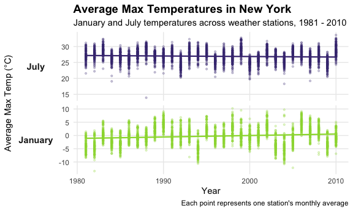
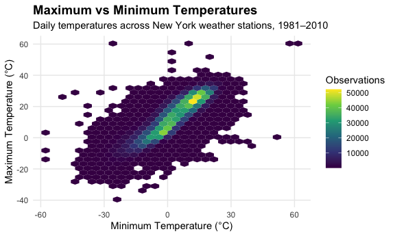
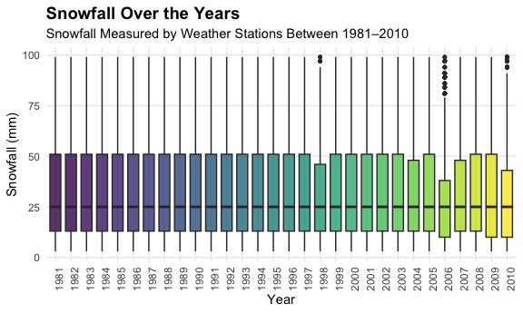

P8105 Homework 3
================
Lina Marcinczyk
2026-10-13

## Problem 1

### Loading and inspecting NY NOAA dataset

``` r
library(p8105.datasets)
data("ny_noaa")
```

The NY NOAA dataset contains 2595176 observations and 7 variables,
representing weather measurements collected at different stations over
time. The variables include station ID (`id`), observation date
(`date`), precipitation (`prcp`), snowfall (`snow`), snow depth
(`snwd`), maximum temperature (`tmax`), and minimum temperature
(`tmin`). The station ID and temperature variables are stored as
character values, the date is stored as a date variable, and the
precipitation and snow measurements are stored as integers.

The dataset contains 3387623 missing values overall. Maximum temperature
(`tmax`) has 1134358 missing observations (43.7%), while minimum
temperature (`tmin`) has 1134420 missing observations (43.7%). In
contrast, station ID and date have no missing values.

### Cleaning the dataset

``` r
ny_noaa_clean = ny_noaa |> 
  mutate(
    year = year(date), 
    month = month(date),
    day = day(date), 
    prcp = prcp / 10, 
    tmax = as.numeric(tmax) / 10, 
    tmin = as.numeric(tmin) / 10
  )
```

##### Snowfall Observations

``` r
ny_noaa_clean |> 
  filter(!is.na(snow)) |> 
  count(snow) |> 
  arrange(desc(n)) |> 
  slice_head(n =10)
```

    ## # A tibble: 10 × 2
    ##     snow       n
    ##    <int>   <int>
    ##  1     0 2008508
    ##  2    25   31022
    ##  3    13   23095
    ##  4    51   18274
    ##  5    76   10173
    ##  6     8    9962
    ##  7     5    9748
    ##  8    38    9197
    ##  9     3    8790
    ## 10   102    6552

The most commonly observed snowfall value is 0 mm, which makes sense
because snowfall does not occur every day. The next most common values
are 25 mm, 13 mm, and 51 mm, which approximately correspond to 1 inch,
0.5 inches, and 2 inches, respectively. This suggests that some snowfall
measurements may have originally been recorded in inches and converted
to millimeters.

##### January and July temps over the years

``` r
ny_noaa_clean |> 
  filter(month %in% c(1, 7)) |> 
  group_by(year, month, id) |> 
  summarize(
    mean_tmax = mean(tmax, na.rm = TRUE),
    .groups = "drop"
  ) |> 
  filter(!is.na(mean_tmax)) |> 
  mutate(
    month = factor(
      month, 
      levels = c(7, 1), 
      labels = c("July", "January")
    )
  ) |> 
  ggplot(aes(x = year, y = mean_tmax)) +
  geom_point(
    aes(color = month),
    alpha = .25,
    size = 0.8
    ) +
  geom_smooth(
    aes(color = month),
    method = "lm",
    se = FALSE, 
    linewidth = 0.8
  ) +
  facet_grid(month ~ ., scales = "free_y", switch = "y") +
  scale_color_viridis_d(
  option = "viridis",
  begin = 0.15,
  end = 0.85
) +
  labs(
    title = "Average Max Temperatures in New York",
    subtitle = "January and July temperatures across weather stations, 1981 - 2010",
    x = "Year",
    y = "Average Max Temp (°C)",
    caption = "Each point represents one station's monthly average",
  ) +
  theme_minimal() +
  theme(
    legend.position = "none",
    plot.title = element_text(face = "bold", size = 14),
    strip.placement = "outside",
    strip.text.y.left = element_text(angle = 0, face = "bold"),
    strip.text = element_text(face = "bold", size = 11), 
    panel.grid.minor = element_blank()
  )
```

    ## `geom_smooth()` using formula = 'y ~ x'



This graph shows clear seasonal differences, as shown with consistently
higher averages in July as compared to January. The trendline shows a
slight increase in January temps from 1981 to 2010, while July temps
remain more or less stable. January temps seem to be more variable than
July ones. There are potential outliers in January around 1982 and 2004,
and in July around 1988 and 2004.

##### Tmax vs Tmin plot

``` r
ny_noaa_clean |>
  filter(!is.na(tmax), !is.na(tmin)) |>
  ggplot(aes(x = tmin, y = tmax)) +
  geom_hex() +
  labs(
  title = "Maximum vs Minimum Temperatures",
  subtitle = "Daily temperatures across New York weather stations, 1981–2010",
  x = "Minimum Temperature (°C)",
  y = "Maximum Temperature (°C)",
  fill = "Observations"
) +
theme_minimal() +
theme(
  plot.title = element_text(face = "bold", size = 14),
  legend.position = "right",
  panel.grid.minor = element_blank()
)
```


This hexagonal plot shows a strong positive relationship between daily
minimum and maximum temperatures across New York weather stations. The
highest concentration of observations occurs at the more moderate
temperatures, with minimum temperatures around 0–20°C and maximum
temperatures around 5–30°C. Some extreme observations are seen, both
unusually high and low temperatures, which may suggest outliers or other
data-quality issues.

##### Snowfall plot

2)  make a plot showing the distribution of snowfall values greater than
    0 and less than 100 separately by year.

``` r
ny_noaa_clean |>
  filter(snow > 0, snow < 100) |> 
  ggplot(aes(x = factor(year), y = snow, fill = factor(year))) +
  geom_boxplot(
    alpha = 0.8,
    width = 0.7,
    outlier.size = 1
  ) +
  labs(
  title = "Snowfall Over the Years",
  subtitle = "Snowfall Measured by Weather Stations Between 1981–2010",
  x = "Year",
  y = "Snowfall (mm)"
) +
theme_minimal() +
theme(
  plot.title = element_text(face = "bold", size = 14),
  legend.position = "none",
  panel.grid.minor = element_blank(),
  axis.text.x = element_text(angle = 90, hjust = 1)
)
```


This boxplot shows that the distribution of daily snowfall amounts
between 0 and 100 mm was relatively consistent across 1981–2010. The
median snowfall was approximately 25 mm in most years, while the middle
50% of observations generally ranged from about 13 to 51 mm. Although
some years showed slightly different variability and a few high snowfall
outliers, there was no clear overall trend in the median snowfall
amount. The similarity across years may partly reflect the concentration
of snowfall measurements at common values such as 13, 25, and 51 mm.
These results describe snowfall amounts on days with recorded snowfall
within the specified range, rather than total annual snowfall.
